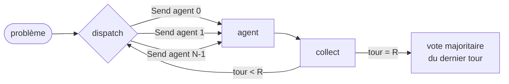

# Débat multi-agents pour le raisonnement mathématique

Le débat entre plusieurs agents LLM améliore-t-il vraiment le raisonnement mathématique,
**à budget de calcul égal**, par rapport à un simple vote majoritaire ?

**Stack :** Python · vLLM · LangGraph · modèles open-weight (Qwen, Llama, Gemma)

> 🚧 Projet en cours de développement.

## Question de recherche

- **Vote majoritaire** (*self-consistency*, Wang et al., 2022) : k réponses indépendantes,
  on garde la plus fréquente.
- **Débat multi-agents** (Du et al., 2023) : N agents répondent, lisent les réponses des
  autres et révisent la leur pendant R tours, puis vote final.

Le débat coûte beaucoup plus de tokens (chaque agent relit les autres à chaque tour). Ce
projet compare les deux méthodes **à nombre de tokens équivalent**, sur GSM8K et MATH-500,
en faisant varier le nombre d'agents, le nombre de tours et la diversité des modèles, et
analyse l'évolution des réponses au fil du débat.

## Roadmap

- [x] Phase 0 : setup (client LLM compatible OpenAI, configuration, CI)
- [x] Phase 1 : données (GSM8K, MATH-500) et vérification des réponses
- [x] Phase 2 : réponse unique, vote majoritaire, comptage des tokens
- [x] Phase 3 : débat avec LangGraph, comparaison à budget égal
- [ ] Phase 4 : expériences sur GPU (vLLM, Kaggle)
- [ ] Phase 5 : analyse (courbes exactitude / tokens, dynamique du débat, tests statistiques)
- [ ] Phase 6 : rapport final

## Données et vérification des réponses

| Benchmark | Source | Problèmes évalués |
| --- | --- | --- |
| **GSM8K** | [openai/grade-school-math](https://github.com/openai/grade-school-math) (test) | 500 tirés au hasard parmi 1 319 (graine 0) |
| **MATH-500** | [HuggingFaceH4/MATH-500](https://huggingface.co/datasets/HuggingFaceH4/MATH-500) | les 500 |

Les sous-ensembles sont **figés** dans [configs/subsets/](configs/subsets/) (listes
d'identifiants versionnées) : toutes les méthodes sont évaluées sur exactement les mêmes
problèmes. Des sous-ensembles `*_dev_30` servent uniquement à mettre au point le code.

**Vérification des réponses** ([src/debate/grading.py](src/debate/grading.py)), commune à
toutes les méthodes :
- le modèle reçoit la consigne standard *« reason step by step, and put your final answer
  within \boxed{} »* ; on extrait le dernier `\boxed{...}` (accolades imbriquées gérées) ;
- **GSM8K** : comparaison numérique (`\$1,234.00` = `1234`), et à défaut de `\boxed` le
  dernier nombre du texte ;
- **MATH-500** : équivalence mathématique avec
  [math-verify](https://github.com/huggingface/Math-Verify) : `\frac{1}{2}` = `0.5`,
  `2\sqrt{3}` = `\sqrt{12}`, `x=5` = `5`, `(x+1)^2` = `x^2+2x+1`, mais `[-2,7]` ≠ `(-2,7)`.

**Validation du vérificateur** : les 1 319 solutions de référence de GSM8K et les 500 de
MATH-500 sont toutes jugées correctes (`make check-grader`), et 27 cas d'équivalence et de
pièges sont couverts par les tests.

## Expériences et journalisation

Une expérience est un fichier YAML ([configs/experiments/](configs/experiments/)) :

```yaml
name: dev_gsm8k_sampling
dataset: gsm8k
subset: configs/subsets/gsm8k_dev_30.txt
method: sampling        # N réponses indépendantes (le débat arrive en phase 3)
model: qwen2.5-instruct:1.5b
n_samples: 5
temperature: 0.7
seed: 0                 # échantillon i généré avec la graine seed + i
```

`debate run <config>` écrit `results/<nom>.jsonl` : **un enregistrement par problème avec
tous les appels au LLM** (texte, réponse extraite, correction, tokens d'entrée et de sortie,
latence, troncature). Toutes les métriques se recalculent à partir de ce journal sans
relancer le modèle. L'exécution est **reprenable** (les problèmes déjà traités sont sautés)
et la configuration est sauvegardée à côté : une reprise avec des paramètres différents est
refusée.

**Méthodes de référence**, calculées à partir des mêmes N échantillons :
- **réponse unique** : exactitude moyenne sur tous les échantillons ;
- **vote@k** : vote majoritaire sur k échantillons, réponses équivalentes regroupées
  (`0.5` et `\frac{1}{2}` comptent ensemble), moyenné sur 20 tirages de k échantillons
  parmi N ;
- **coût** : tokens par problème pour chaque k, qui servira à placer le débat sur la même
  échelle.

Essai de mise au point en local (`make dev-run` : Qwen2.5-1.5B sur CPU, 10 problèmes GSM8K
× 5 échantillons, 12 minutes) — **à titre de vérification du pipeline uniquement**, 10
problèmes ne permettent aucune conclusion :

| k | vote@k | tokens / problème |
| --- | --- | --- |
| 1 | 57.5% | 399 |
| 3 | 64.5% | 1197 |
| 5 | 60.0% | 1995 |

Aucune réponse non extraite ni tronquée ; le coût croît linéairement avec k (399 tokens par
échantillon).

## Débat multi-agents (LangGraph)



- **Tour 1** : chaque agent résout seul le problème, avec la même consigne que
  l'échantillonnage. Avec `initial_answers`, le tour 1 **reprend les N premiers
  échantillons** d'une expérience de vote au lieu de les régénérer : débat et vote partent
  exactement des mêmes réponses initiales, ce qui isole l'effet des tours de révision (et
  économise du calcul ; leurs tokens restent comptés dans le coût du débat). Fixer la même
  graine ne suffit pas : un serveur qui regroupe les requêtes en batch ne produit pas des
  sorties identiques d'une exécution à l'autre (0 réponse identique sur 30 lors d'un essai).
- **Tour r > 1** : chaque agent relit sa propre réponse et celles des autres agents au
  tour r-1, puis donne une réponse révisée (protocole de Du et al., 2023). Seul le tour
  précédent est conservé dans le contexte, pour que la longueur du prompt ne croisse pas avec
  le nombre de tours.
- **Parallélisme** : `dispatch` envoie un message `Send` par agent ; les N agents d'un tour
  s'exécutent en parallèle et leurs réponses sont fusionnées par un *reducer*, puis triées
  par agent (l'ordre d'arrivée n'étant pas garanti).
- **Débat hétérogène** : `models: [qwen, llama, gemma]` attribue un modèle par agent
  (répété cycliquement si N dépasse la liste).

**Mesures** (`debate report`) : exactitude finale, exactitude par tour (vote des agents et
agent moyen), taux d'unanimité, **transitions entre tours** (correct→faux, faux→correct...)
et coût en tokens.

### Comparaison à budget égal

`debate compare <débat> <échantillonnage>` place le débat sur la courbe du vote :

1. coût du débat = somme des tokens de tous ses appels (entrée + sortie), moyenné par
   problème ;
2. k équivalent = coût du débat / coût moyen d'un échantillon indépendant ;
3. exactitude du vote à ce budget = interpolation linéaire de la courbe vote@k (sans
   extrapolation au-delà du plus grand k mesuré).

Deux budgets sont rapportés : **tokens totaux** (entrée + sortie, ce que coûte réellement le
débat, dont les prompts gonflent avec les réponses des autres) et **tokens générés**
seulement (plus favorable au débat).

Essai de mise au point en local (`make dev-run` : Qwen2.5-1.5B, 10 problèmes GSM8K, débat
3 agents × 2 tours dont le tour 1 reprend l'échantillonnage) — **vérification du pipeline
uniquement**, sans valeur statistique :

| Tour | vote des agents | agent moyen | unanimité |
| --- | --- | --- | --- |
| 1 | 60.0% | 50.0% | 10.0% |
| 2 | 50.0% | 60.0% | 50.0% |

Transitions tour 1 → 2 (30 réponses d'agents) : correct→correct 12, faux→correct 6,
correct→faux 3, faux→faux 9. Coût : 5 550 tokens par problème, soit l'équivalent de **14
échantillons indépendants** en tokens totaux (6 en tokens générés) : les expériences sur GPU
devront générer jusqu'à ~32 échantillons par problème pour que la courbe du vote couvre le
budget des débats.

## Calcul

| | Où | Serveur | Modèles |
| --- | --- | --- | --- |
| Développement | CPU local | Ollama | Qwen2.5-1.5B-Instruct |
| Expériences | Kaggle (GPU T4, gratuit) | vLLM | modèles open-weight 1,5 à 3B |

Ollama et vLLM exposent tous deux une API compatible OpenAI : le même code tourne dans les
deux environnements, seule `LLM_BASE_URL` change.

## Installation

Prérequis : Python 3.11+, [uv](https://docs.astral.sh/uv/), [Ollama](https://ollama.com)
pour le développement local.

```bash
cp .env.example .env
make install
make models                         # télécharge Qwen2.5-1.5B-Instruct pour Ollama
make ping                           # vérifie la connexion au serveur LLM
make check-grader                   # télécharge les données et valide le vérificateur
make dev-run                        # essai local : 10 problèmes × 5 échantillons
make test
```

## Licence

MIT
