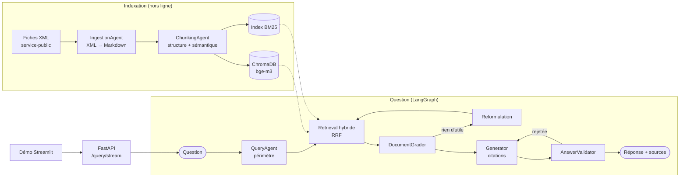

# Système RAG multi-agents sur documents métier

[](https://github.com/Touayouch/AI-projects/actions/workflows/rag-multi-agents.yml)


Assistant de questions-réponses sur le **droit du travail et la protection sociale**, qui
répond à partir de **875 fiches officielles service-public.gouv.fr** en citant ses sources.
Le pipeline est orchestré par des **agents spécialisés** (filtrage, recherche hybride, tri,
génération, validation) avec **LangGraph**, et tourne **entièrement en local, sans GPU**
(Ollama + Qwen3-4B).

**Stack :** LangChain · LangGraph · ChromaDB · FastAPI · Ollama · RAGAS · Streamlit · Docker

## En bref

| | |
| --- | --- |
| Corpus | 875 fiches → 14 947 chunks (chunking sémantique guidé par la structure) |
| Retrieval hybride dense + BM25 (44 questions annotées) | MRR@10 **0.788** vs 0.753 dense seul, hit@1 **0.75** |
| Fidélité RAGAS (100 questions) | **0.91** |
| Pertinence RAGAS (100 questions) | **0.77** |
| Questions hors périmètre refusées | **8/8**, 0 refus à tort sur 85 questions légitimes |
| Réponses hors sujet renvoyées, sans → avec validateur | **9 → 5** |
| Latence | ~90 s par question sur CPU (Ryzen 5, sans GPU) |

## Architecture



## Démo

```bash
make api    # API FastAPI sur http://localhost:8080 (Swagger : /docs)
make demo   # interface Streamlit sur http://localhost:8501
```

L'interface affiche la progression du graphe en direct (analyse → recherche → tri →
rédaction → contrôle qualité), puis la réponse, son statut et les fiches sources cliquables.

## Corpus

**875 fiches pratiques** de [service-public.gouv.fr](https://www.service-public.gouv.fr)
(thèmes *Travail - Formation* et *Social - Santé*) : congés, contrat de travail, licenciement,
chômage, retraite, santé... Données ouvertes publiées par la DILA sous
[Licence Ouverte](https://www.etalab.gouv.fr/licence-ouverte-open-licence/).

Un corpus juridique riche en termes exacts (CDD, CSE, RSA, article L1234-9...), idéal pour
mettre en évidence l'intérêt d'un retrieval hybride dense + lexical.

## Pipeline d'ingestion

```
fiches XML ──► IngestionAgent ──► ChunkingAgent ──► ChromaDB (dense)
               parsing XML→Markdown  sections (titres)     + chunks.jsonl (index BM25)
               nettoyage, dédup       + regroupement sémantique
```

- **IngestionAgent** : convertit la structure XML (chapitres, cas, encadrés, tableaux) en
  Markdown hiérarchique, extrait les métadonnées (thème, URL, date) et déduplique par hash.
- **ChunkingAgent** : découpe d'abord selon la structure (titres), puis regroupe les blocs
  consécutifs d'une section tant qu'ils restent sémantiquement proches (rupture au-delà du
  90e percentile des distances cosinus entre blocs voisins). Chaque chunk est préfixé par son
  fil d'Ariane (`Fiche > Chapitre > Cas`) pour rester compréhensible isolément.
  Une stratégie `recursive` (baseline) permet de comparer les deux approches.

## Retrieval hybride

```
                 ┌─► DenseRetriever (bge-m3, ChromaDB, cosinus) ─┐
question ────────┤                                               ├─► fusion RRF ─► top k
                 └─► BM25Retriever (rank-bm25, français)  ───────┘
```

- **Dense** : capte les reformulations (« quitter mon poste de mon plein gré » → démission).
- **BM25** : capte les termes exacts que les embeddings diluent (sigles *PPV*, *C2P*, *CD2I*,
  références *L1234-9*). Tokenisation française : élisions, mots vides, racinisation Snowball,
  suppression des accents.
- **Reciprocal Rank Fusion** : `score(d) = Σ poids_r / (60 + rang_r(d))`. Ne combine que les
  rangs, donc pas besoin de normaliser des scores BM25 (non bornés) et cosinus.

### Évaluation

44 questions annotées à la main ([eval/retrieval_questions.jsonl](eval/retrieval_questions.jsonl)),
moitié formulées avec les termes exacts de la fiche (`lexical`), moitié reformulées en langage
courant (`paraphrase`). Un résultat est pertinent s'il provient de la fiche qui contient la
réponse.

Résultats sur le corpus complet (14 947 chunks, chunking sémantique, embeddings `bge-m3`) —
rapport détaillé : [eval/results/retrieval_semantic.md](eval/results/retrieval_semantic.md)

| Méthode | hit@1 | hit@5 | hit@10 | MRR@10 |
| --- | --- | --- | --- | --- |
| Dense (bge-m3) | 0.68 | **0.86** | **0.89** | 0.753 |
| BM25 | 0.55 | 0.68 | 0.73 | 0.598 |
| **Hybride (RRF)** | **0.75** | 0.84 | 0.86 | **0.788** |

| Par type de question (MRR@10) | Dense | BM25 | Hybride |
| --- | --- | --- | --- |
| Termes exacts (20 questions) | 0.938 | 0.908 | **0.975** |
| Reformulations (24 questions) | 0.600 | 0.339 | **0.632** |

**Lecture :**
- BM25 seul est très bon sur les termes exacts mais s'effondre sur les reformulations
  (vocabulaire différent de la fiche) : le dense est indispensable.
- L'hybride met plus souvent la bonne fiche **en première position** (hit@1 +7 points,
  MRR +0.035), ce qui compte le plus pour la génération.
- En contrepartie, il perd une question en hit@5/hit@10 : sur une reformulation, BM25 peut
  remonter des chunks hors sujet qui partagent des mots courants.
- Avec 44 questions, une question = 0.023 point : les écarts sont indicatifs. Les poids de
  fusion sont laissés à 1/1 plutôt qu'ajustés sur ce jeu de test (un balayage 0.3 → 1.0 du
  poids BM25 ne change le résultat que d'une question).

```bash
make eval-retrieval
uv run rag search "Combien de jours de congé pour un Pacs ?"
```

## Orchestration multi-agents (LangGraph)


| Agent | Rôle | Sortie |
| --- | --- | --- |
| **QueryAgent** (`analyze`, `rewrite`) | Filtre les questions hors périmètre (tolérant au langage familier) ; reformule la requête seulement si rien de pertinent n'est trouvé | `QueryAnalysis` (JSON structuré) |
| **Retriever** (`retrieve`) | Recherche hybride dense + BM25 | top 5 chunks |
| **DocumentGrader** (`grade`) | Écarte les chunks non pertinents (un seul appel LLM pour tous les chunks) | indices des chunks utiles |
| **Generator** (`generate`) | Rédige la réponse à partir des seuls chunks retenus, avec citations `[n]` | texte |
| **AnswerValidator** (`validate`) | Vérifie la fidélité aux sources et la pertinence ; en cas d'échec, son retour est renvoyé au générateur | `Validation` |

Garde-fous :
- 1 reformulation et 1 régénération au maximum (pas de boucle infinie). Si la réponse reste
  rejetée, le système renvoie les fiches sources plutôt qu'une réponse non fiable
  (statut `unverified`).
- La première recherche utilise la question d'origine : avec un modèle de 4B, une
  reformulation systématique déviait du sujet (« pacs » reformulé en « congé de maternité »).
- Chaque nœud est relancé jusqu'à 3 fois en cas d'erreur passagère (serveur Ollama
  indisponible, JSON mal formé).

Le LLM par défaut est **Qwen3-4B-Instruct-2507** (quantifié Q4_K_M) via Ollama, en local et
sans GPU. La variante *Instruct* répond directement, sans phase de raisonnement (*thinking*)
qui multiplierait la latence sur CPU. Les sorties structurées (Pydantic + JSON schema) fiabilisent les
décisions de routage d'un petit modèle.

Exemple (`uv run rag ask "Dois-je payer l'ordinateur de ma boîte que j'ai cassé ?" -v`) :

```
Étapes :
  - analyze: in_scope=True
  - retrieve: 5 chunks
  - grade: 2/5 chunks pertinents
  - generate: tentative 1
  - validate: grounded=True answers_question=True

Non, vous n'avez pas à payer l'ordinateur [...] l'employeur ne peut pas demander au salarié de
rembourser les dégradations ou la perte du matériel s'il a été cassé ou perdu involontairement
[1]. [...] Les sanctions financières, comme le retrait du prix de l'objet sur le salaire, sont
interdites [2].

Sources :
  [1] Un salarié doit-il rembourser du matériel de l'entreprise cassé ou perdu ?
  [2] Que peut faire un particulier employeur si son salarié casse un objet ?
```

Latence sur CPU (Ryzen 5, sans GPU) : 60 à 120 s par question (4 appels au LLM), quelques
secondes pour une question hors périmètre.

```bash
uv run rag ask "Combien de jours de congé pour un Pacs ?" --verbose
uv run rag graph   # diagramme Mermaid généré depuis le code
```

## Évaluation de bout en bout (RAGAS)

100 questions ([eval/ragas_questions.jsonl](eval/ragas_questions.jsonl)) : 85 avec réponse
dans le corpus (42 en termes exacts, 43 reformulées), 8 hors périmètre (cuisine, sport...),
7 sans réponse dans les fiches (SMIC de 1975, numéro de téléphone d'une agence...).
Rapport complet : [eval/results/rag_report.md](eval/results/rag_report.md), réponses et
scores question par question dans `eval/results/rag_*.jsonl`.

| Indicateur | Résultat |
| --- | --- |
| **Fidélité RAGAS** (*faithfulness*, 85 réponses) | **0.91** |
| **Pertinence RAGAS** (*answer relevancy*, 85 réponses) | **0.77** |
| Questions hors périmètre refusées | 8/8 |
| Questions sans réponse : le système s'abstient ou dit ne pas savoir | 7/7 |
| Questions légitimes refusées à tort | 0/85 |
| Retrieval hit@5 dans le pipeline | 0.88 |
| Latence médiane (CPU, sans GPU) | 87 s |

**Détection et remédiation des réponses hors sujet.** Une réponse est comptée hors sujet /
non fidèle si sa pertinence ou sa fidélité RAGAS est < 0.5. En scorant le premier brouillon
de chaque réponse (ce qu'un pipeline sans validateur aurait renvoyé) et la réponse finale :

| | Sans validateur | Avec validateur |
| --- | --- | --- |
| Fidélité moyenne | 0.89 | 0.91 |
| Pertinence moyenne | 0.73 | 0.77 |
| Réponses hors sujet / non fidèles présentées comme des réponses | 9 | 5 |

**Lecture honnête de ces résultats :**
- Le gain vient surtout de la détection des non-réponses : 4 réponses du type « les extraits
  ne permettent pas de répondre » sont reclassées `no_answer` au lieu d'être présentées comme
  des réponses. La boucle de régénération ne s'est déclenchée qu'une fois : avec un modèle 4B
  qui se juge lui-même, le validateur est indulgent.
- Sur les 5 cas restants, 3 sont des « je ne sais pas » que le validateur n'a pas reconnus
  (statut `answered` au lieu de `no_answer`) ; 2 sont de vrais défauts (une affirmation non
  sourcée sur le télétravail, une pertinence à 0 probablement due au juge).
- 1 question avec réponse n'a pas trouvé la bonne fiche (contrat de sécurisation
  professionnelle) : le système a répondu qu'il n'avait pas l'information plutôt que
  d'inventer.

**Limites :** le juge RAGAS est le même modèle local de 4B que le générateur (pas d'API
externe) ; ses notes sont moins fiables que celles d'un grand modèle et potentiellement
indulgentes envers ses propres réponses. Les métriques RAGAS utilisées (faithfulness, answer
relevancy) ne nécessitent pas de réponse de référence : elles mesurent la fidélité aux
sources et la pertinence, pas l'exactitude juridique.

```bash
make eval-rag   # ~5 h sur CPU, reprenable après interruption
```

## API (FastAPI)

| Méthode | Route | Rôle |
| --- | --- | --- |
| `GET` | `/health` | État du service et de la connexion à Ollama (`ok` / `degraded`) |
| `POST` | `/search` | Recherche seule (`dense`, `sparse` ou `hybrid`), en quelques centaines de ms |
| `POST` | `/query` | Réponse complète via le graphe multi-agents |
| `POST` | `/query/stream` | Idem en *Server-Sent Events* : un événement par étape du graphe, puis la réponse |

Documentation interactive (Swagger) : http://localhost:8080/docs

```bash
make api   # serveur de développement sur le port 8080

curl -X POST localhost:8080/query -H "Content-Type: application/json" \
     -d '{"question": "Combien de jours de congé pour un Pacs ?", "verbose": true}'
```

```json
{
  "question": "Combien de jours de congé pour un Pacs ?",
  "answer": "Vous avez droit à 4 jours de congé pour un Pacs [1]. [...]",
  "status": "answered",
  "sources": [{"n": 1, "title": "Congé du salarié pour mariage ou Pacs", "url": "https://www.service-public.gouv.fr/particuliers/vosdroits/F34154", "...": "..."}],
  "steps": ["analyze: in_scope=True", "retrieve: 5 chunks", "grade: 1/5 chunks pertinents", "generate: tentative 1", "validate: grounded=True answers_question=True"],
  "latency_s": 90.1
}
```

La génération prenant 1 à 2 minutes sur CPU, `/query/stream` permet d'afficher la
progression (`analyze` → `retrieve` → `grade` → `generate` → `validate`) au fil de l'eau :

```bash
curl -N -X POST localhost:8080/query/stream -H "Content-Type: application/json" \
     -d '{"question": "Mon employeur peut-il me demander un justificatif d absence ?"}'
```

Le graphe et les index (BM25, ChromaDB) sont chargés une seule fois au démarrage ; les
routes synchrones s'exécutent dans le pool de threads de FastAPI. Une panne d'Ollama renvoie
une erreur `503` explicite.

### Docker

```bash
make ingest      # une fois : construit l'index dans data/
make docker-up   # API (port 8080) + Ollama
```

`docker-compose.yml` lance l'API et un conteneur Ollama. L'index `data/` est monté dans le
conteneur, et les modèles déjà téléchargés sur la machine hôte sont réutilisés
(`OLLAMA_MODELS_DIR`, par défaut `/usr/share/ollama/.ollama/models`). La CI construit l'image
à chaque push.

## Choix techniques

- **Tout en local (Ollama, CPU)** : aucune donnée envoyée à une API externe, coût nul, mais
  une latence de 1 à 2 minutes par question. Le fournisseur de LLM est configurable
  (`LLM_PROVIDER=anthropic|openai`) pour un déploiement plus rapide.
- **Chunking guidé par la structure** : les fiches ont une hiérarchie riche (chapitres, cas,
  encadrés) ; découper d'abord par titres puis regrouper sémantiquement évite de couper un
  « cas » en deux, et le fil d'Ariane rend chaque chunk autonome.
- **RRF plutôt qu'une somme de scores** : pas de normalisation fragile entre BM25 et cosinus.
- **Sorties structurées (Pydantic + JSON schema)** pour toutes les décisions de routage : un
  modèle de 4B produit alors des décisions exploitables de façon fiable.
- **Un seul appel LLM pour trier 5 chunks** (au lieu de 5) : divise la latence de cette étape.
- **Évaluation reprenable** (JSONL ligne par ligne) : indispensable quand une évaluation dure
  5 heures sur CPU.

## Limites et pistes d'amélioration

- **Juge RAGAS = générateur** : les scores seraient plus fiables avec un juge plus grand
  (API) ; le validateur interne, lui aussi en 4B, est indulgent (1 seule régénération sur 100
  questions).
- **Détection des non-réponses incomplète** : 3 réponses « je ne sais pas » restent étiquetées
  `answered` ; une règle déterministe en complément du validateur réglerait ces cas.
- **Latence** : un GPU, un modèle servi par vLLM, ou le parallélisme des nœuds indépendants
  la réduiraient fortement.
- **Pas de reranker** : un cross-encoder (ex. `bge-reranker-v2-m3`) améliorerait probablement
  hit@1, au prix d'une latence supplémentaire.
- **Fraîcheur** : le corpus est figé à la date d'ingestion ; une mise à jour incrémentale
  (via la date de modification des fiches) serait nécessaire en production.

## Structure

```
src/rag/
├── agents/        # agents spécialisés (ingestion, chunking, query, grader, generator, validator)
├── ingestion/     # téléchargement du corpus, parsing XML
├── retrieval/     # dense (ChromaDB), sparse (BM25), hybride (RRF)
├── evaluation/    # retrieval (hit@k, MRR) et bout en bout (RAGAS)
├── api/           # FastAPI (routes, schémas Pydantic)
├── graph.py       # graphe LangGraph (orchestration des agents)
├── indexing.py    # ChromaDB + export JSONL
├── models.py      # LLM et embeddings Ollama + cache SQLite
├── cli.py         # commande `rag`
└── config.py      # configuration (.env)
demo/app.py        # interface Streamlit (client de l'API)
eval/              # questions annotées et rapports d'évaluation
tests/
```

## Installation

Prérequis : Python 3.11+, [uv](https://docs.astral.sh/uv/), [Ollama](https://ollama.com).

```bash
cp .env.example .env
make install
make models             # télécharge bge-m3 (embeddings) et Qwen3-4B-Instruct (LLM)
make corpus             # télécharge et filtre les fiches dans data/raw/
make ingest             # ingestion + chunking sémantique + indexation ChromaDB (~3 h sur CPU)
make ingest-recursive   # baseline pour comparaison
make eval-retrieval     # compare dense / BM25 / hybride
make eval-rag           # évaluation RAGAS sur 100 questions (~5 h sur CPU)
make test
make api                # API sur le port 8080
make demo               # interface Streamlit sur le port 8501
```

Les statistiques de chunking sont écrites dans `data/processed/stats_<stratégie>.json`.
Les embeddings sont mis en cache (`data/processed/embeddings_cache.sqlite`) : une ingestion
interrompue reprend là où elle s'était arrêtée.

## Licence

Code sous licence MIT. Corpus : Licence Ouverte / Open Licence (DILA).
