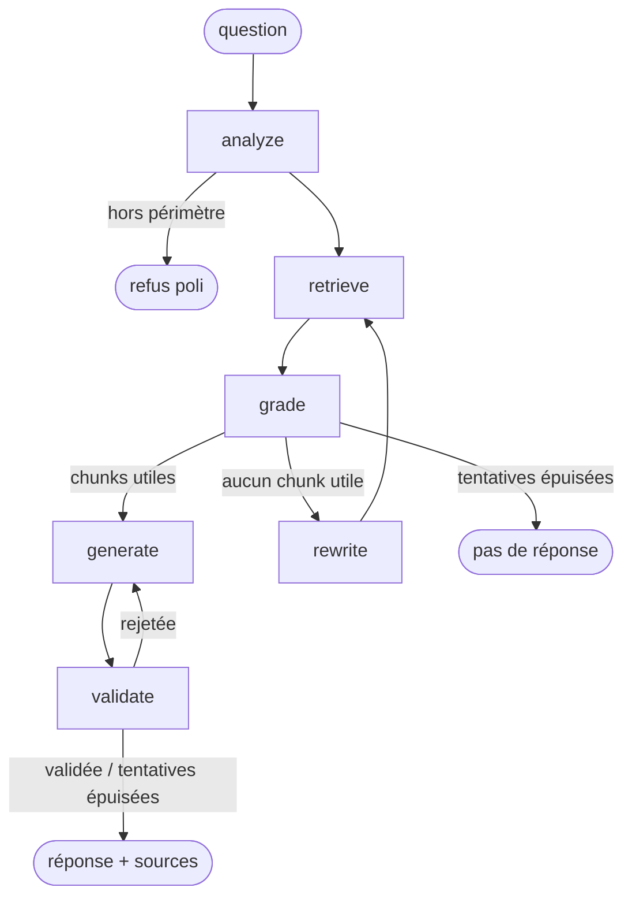

# Système RAG multi-agents sur documents métier

Pipeline RAG multi-étapes orchestré par des agents spécialisés (ingestion, chunking sémantique,
retrieval hybride dense/sparse, validation qualité, génération), évalué automatiquement avec RAGAS.

**Stack :** LangChain · LangGraph · ChromaDB · FastAPI · Ollama

> 🚧 Projet en cours de développement.

## Corpus

**875 fiches pratiques** de [service-public.gouv.fr](https://www.service-public.gouv.fr)
(thèmes *Travail - Formation* et *Social - Santé*) : congés, contrat de travail, licenciement,
chômage, retraite, santé... Données ouvertes publiées par la DILA sous
[Licence Ouverte](https://www.etalab.gouv.fr/licence-ouverte-open-licence/).

Un corpus juridique riche en termes exacts (CDD, CSE, RSA, article L1234-9...), idéal pour
mettre en évidence l'intérêt d'un retrieval hybride dense + lexical.

## Roadmap

- [x] Phase 0 : setup du projet
- [x] Phase 1 : ingestion et chunking sémantique
- [x] Phase 2 : retrieval hybride (dense + BM25 + fusion RRF)
- [x] Phase 3 : orchestration multi-agents (LangGraph)
- [ ] Phase 4 : évaluation RAGAS et remédiation hors-sujet
- [ ] Phase 5 : API FastAPI et Docker
- [ ] Phase 6 : documentation, démo

## Pipeline d'ingestion

```
fiches XML ──► IngestionAgent ──► ChunkingAgent ──► ChromaDB (dense)
               parsing XML→Markdown  sections (titres)     + chunks.jsonl (BM25, phase 2)
               nettoyage, dédup       + regroupement sémantique
```

- **IngestionAgent** : convertit la structure XML (chapitres, cas, encadrés, tableaux) en
  Markdown hiérarchique, extrait les métadonnées (thème, URL, date) et déduplique par hash.
- **ChunkingAgent** : découpe d'abord selon la structure (titres), puis regroupe les blocs
  consécutifs d'une section tant qu'ils restent sémantiquement proches (rupture au-delà du
  90e percentile des distances cosinus entre blocs voisins). Chaque chunk est préfixé par son
  fil d'Ariane (`Fiche > Chapitre > Cas`) pour rester compréhensible isolément.
  Une stratégie `recursive` (baseline) permet de comparer les deux approches.

## Retrieval hybride

```
                 ┌─► DenseRetriever (bge-m3, ChromaDB, cosinus) ─┐
question ────────┤                                               ├─► fusion RRF ─► top k
                 └─► BM25Retriever (rank-bm25, français)  ───────┘
```

- **Dense** : capte les reformulations (« quitter mon poste de mon plein gré » → démission).
- **BM25** : capte les termes exacts que les embeddings diluent (sigles *PPV*, *C2P*, *CD2I*,
  références *L1234-9*). Tokenisation française : élisions, mots vides, racinisation Snowball,
  suppression des accents.
- **Reciprocal Rank Fusion** : `score(d) = Σ poids_r / (60 + rang_r(d))`. Ne combine que les
  rangs, donc pas besoin de normaliser des scores BM25 (non bornés) et cosinus.

### Évaluation

44 questions annotées à la main ([eval/retrieval_questions.jsonl](eval/retrieval_questions.jsonl)),
moitié formulées avec les termes exacts de la fiche (`lexical`), moitié reformulées en langage
courant (`paraphrase`). Un résultat est pertinent s'il provient de la fiche qui contient la
réponse.

Résultats sur le corpus complet (14 947 chunks, chunking sémantique, embeddings `bge-m3`) —
rapport détaillé : [eval/results/retrieval_semantic.md](eval/results/retrieval_semantic.md)

| Méthode | hit@1 | hit@5 | hit@10 | MRR@10 |
| --- | --- | --- | --- | --- |
| Dense (bge-m3) | 0.68 | **0.86** | **0.89** | 0.753 |
| BM25 | 0.55 | 0.68 | 0.73 | 0.598 |
| **Hybride (RRF)** | **0.75** | 0.84 | 0.86 | **0.788** |

| Par type de question (MRR@10) | Dense | BM25 | Hybride |
| --- | --- | --- | --- |
| Termes exacts (20 questions) | 0.938 | 0.908 | **0.975** |
| Reformulations (24 questions) | 0.600 | 0.339 | **0.632** |

**Lecture :**
- BM25 seul est très bon sur les termes exacts mais s'effondre sur les reformulations
  (vocabulaire différent de la fiche) : le dense est indispensable.
- L'hybride met plus souvent la bonne fiche **en première position** (hit@1 +7 points,
  MRR +0.035), ce qui compte le plus pour la génération.
- En contrepartie, il perd une question en hit@5/hit@10 : sur une reformulation, BM25 peut
  remonter des chunks hors sujet qui partagent des mots courants.
- Avec 44 questions, une question = 0.023 point : les écarts sont indicatifs. Les poids de
  fusion sont laissés à 1/1 plutôt qu'ajustés sur ce jeu de test (un balayage 0.3 → 1.0 du
  poids BM25 ne change le résultat que d'une question).

```bash
make eval-retrieval
uv run rag search "Combien de jours de congé pour un Pacs ?"
```

## Orchestration multi-agents (LangGraph)



| Agent | Rôle | Sortie |
| --- | --- | --- |
| **QueryAgent** (`analyze`, `rewrite`) | Filtre les questions hors périmètre (tolérant au langage familier) ; reformule la requête seulement si rien de pertinent n'est trouvé | `QueryAnalysis` (JSON structuré) |
| **Retriever** (`retrieve`) | Recherche hybride dense + BM25 (phase 2) | top 5 chunks |
| **DocumentGrader** (`grade`) | Écarte les chunks non pertinents (un seul appel LLM pour tous les chunks) | indices des chunks utiles |
| **Generator** (`generate`) | Rédige la réponse à partir des seuls chunks retenus, avec citations `[n]` | texte |
| **AnswerValidator** (`validate`) | Vérifie la fidélité aux sources et la pertinence ; en cas d'échec, son retour est renvoyé au générateur | `Validation` |

Garde-fous :
- 1 reformulation et 1 régénération au maximum (pas de boucle infinie). Si la réponse reste
  rejetée, le système renvoie les fiches sources plutôt qu'une réponse non fiable
  (statut `unverified`).
- La première recherche utilise la question d'origine : avec un modèle de 4B, une
  reformulation systématique déviait du sujet (« pacs » reformulé en « congé de maternité »).
- Chaque nœud est relancé jusqu'à 3 fois en cas d'erreur passagère (serveur Ollama
  indisponible, JSON mal formé).

Le LLM par défaut est **Qwen3-4B-Instruct-2507** (quantifié Q4_K_M) via Ollama, en local et
sans GPU. La variante *Instruct* répond directement, sans phase de raisonnement (*thinking*)
qui multiplierait la latence sur CPU. Les sorties structurées (Pydantic + JSON schema) fiabilisent les
décisions de routage d'un petit modèle.

Exemple (`uv run rag ask "Dois-je payer l'ordinateur de ma boîte que j'ai cassé ?" -v`) :

```
Étapes :
  - analyze: in_scope=True
  - retrieve: 5 chunks
  - grade: 2/5 chunks pertinents
  - generate: tentative 1
  - validate: grounded=True answers_question=True

Non, vous n'avez pas à payer l'ordinateur [...] l'employeur ne peut pas demander au salarié de
rembourser les dégradations ou la perte du matériel s'il a été cassé ou perdu involontairement
[1]. [...] Les sanctions financières, comme le retrait du prix de l'objet sur le salaire, sont
interdites [2].

Sources :
  [1] Un salarié doit-il rembourser du matériel de l'entreprise cassé ou perdu ?
  [2] Que peut faire un particulier employeur si son salarié casse un objet ?
```

Latence sur CPU (Ryzen 5, sans GPU) : 60 à 120 s par question (4 appels au LLM), quelques
secondes pour une question hors périmètre.

```bash
uv run rag ask "Combien de jours de congé pour un Pacs ?" --verbose
uv run rag graph   # diagramme Mermaid généré depuis le code
```

## Structure

```
src/rag/
├── agents/        # agents spécialisés (ingestion, chunking, query, grader, generator, validator)
├── ingestion/     # téléchargement du corpus, parsing XML
├── retrieval/     # dense (ChromaDB), sparse (BM25), hybride (RRF)
├── evaluation/    # métriques de retrieval (hit@k, MRR)
├── api/           # FastAPI
├── graph.py       # graphe LangGraph (orchestration des agents)
├── indexing.py    # ChromaDB + export JSONL
├── models.py      # LLM et embeddings Ollama + cache SQLite
├── cli.py         # commande `rag`
└── config.py      # configuration (.env)
eval/              # questions annotées et rapports d'évaluation
tests/
```

## Installation

Prérequis : Python 3.11+, [uv](https://docs.astral.sh/uv/), [Ollama](https://ollama.com).

```bash
cp .env.example .env
make install
make models             # télécharge bge-m3 (embeddings) et Qwen3-4B-Instruct (LLM)
make corpus             # télécharge et filtre les fiches dans data/raw/
make ingest             # ingestion + chunking sémantique + indexation ChromaDB (~3 h sur CPU)
make ingest-recursive   # baseline pour comparaison
make eval-retrieval     # compare dense / BM25 / hybride
make test
```

Les statistiques de chunking sont écrites dans `data/processed/stats_<stratégie>.json`.
Les embeddings sont mis en cache (`data/processed/embeddings_cache.sqlite`) : une ingestion
interrompue reprend là où elle s'était arrêtée.

## Licence

Code sous licence MIT. Corpus : Licence Ouverte / Open Licence (DILA).
